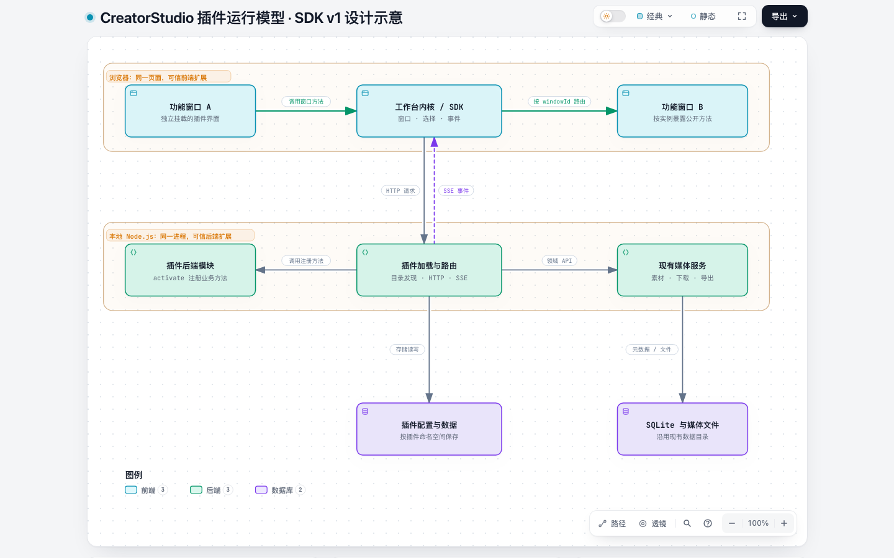
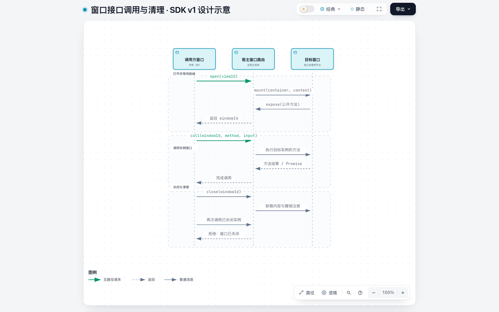

# 架构与关键设计

CreatorStudio 是仅监听本机的浏览器工作台。工作台内核管理窗口和插件，现有媒体后端提供领域能力；第三方通过统一 SDK 扩展界面与后端方法。

## 插件运行模型

图由 archify 生成，表示 SDK v1 设计，不绑定某个 Git 提交。浏览器与 Node.js 是运行边界；图中的插件模块不是安全沙箱。

- 前端插件是独立构建的 ES 模块，在同一浏览器页面创建自己的挂载根节点。
- 后端插件作为 Node.js ES 模块导入本地服务进程。
- 内置插件与第三方插件经过同一加载器，宿主没有按业务窗口类型选择组件的分支。
- 前端窗口间通过内存注册表调用；前后端通过 HTTP 调用，事件通过 SSE 通知。
- 现有素材、下载和导出服务仍负责数据库、文件与 FFmpeg / yt-dlp 操作。

这是可信代码扩展模型：安装插件等于允许它在所在进程的权限下运行，不提供逐插件的磁盘、网络、故障或依赖隔离。

## 加载与分发

`packages/plugin-sdk` 分发清单、领域数据和前后端接口契约；浏览器专用类型位于 `/browser`，服务端类型位于 `/server`，避免服务端类型依赖 DOM。

服务启动时扫描：

1. `plugins/builtin/dist`：随工作台构建的五类内置插件。
2. `<数据目录>/plugins`：用户安装的独立插件包。

插件清单声明 SDK 版本、前后端入口、样式和窗口定义。SDK 版本、插件标识及窗口标识冲突会在启动时直接报错。后端 `activate` 注册业务方法，方法生命周期与服务相同。

浏览器读取 `/api/plugins`，加载插件 CSS 和 ES 模块，建立窗口目录，再恢复布局和挂载窗口。可选前端 `activate` 在宿主渲染后执行，可通过 SDK 打开窗口。

内置插件由 React 实现，但 React、QueryClient 和组件均由插件自身持有；宿主只接收 `mount(container, context)` 和清理函数。第三方插件可以使用原生 DOM 或其他框架。

开发期 Vite `127.0.0.1:8088` 将 `/api` 和 `/plugins` 代理至 Fastify `127.0.0.1:3000`。构建后 Fastify 同时托管宿主页面和插件产物。

## 窗口接口与生命周期

- `viewId` 标识插件贡献的窗口类型，例如 `studio.editor/main`；`windowId` 标识某个已打开的实例。
- 单例或多实例由插件清单声明。五个现有内置窗口默认单例，独立示例演示多实例。
- `open()` 在窗口挂载并注册接口后返回句柄。`call(windowId, method, input)` 始终调用具体实例，结果统一为 Promise。
- 最小化保留挂载内容和实例接口。关闭时统一撤销接口、回收 SDK 订阅并调用插件清理函数。
- 关闭后的实例调用会拒绝；重新打开会创建新的 ID。插件后端方法不受窗口关闭影响。
- 窗口接口只属于当前页面，不跨浏览器标签页路由。后端不直接操作窗口，通过事件通知界面。

每个插件清理自己的框架根节点、媒体、DOM 与定时器；宿主作用域回收公开接口及 SDK 事件和选择订阅。

## 状态归属与通知

| 状态 | 归属与持久化 |
| --- | --- |
| 窗口位置、尺寸、层级、最小化及输入 | 宿主布局 store，浏览器 localStorage v2 |
| 当前选择的素材 | 独立选择服务，浏览器 localStorage；通过快照和订阅访问 |
| 素材、下载、导出数据 | 现有后端媒体服务及 SQLite |
| 插件配置和业务小数据 | `plugin-data/<pluginId>/storage.json`，按插件命名空间保存 |
| 界面草稿、播放位置、查询缓存 | 插件窗口实例；最小化保留，关闭释放 |

布局升级不迁移旧版窗口记录；现有 SQLite、媒体和任务数据保持原样。窗口布局不是剪辑项目文档，不在其中保存时间轴业务对象。

事件统一为 `{ topic, payload }`，使用 SSE 的 `studio` 事件传输。素材、下载和导出变化分别发出 `media.assets.changed`、`media.downloads.changed`、`media.exports.changed`。插件自行根据通知刷新查询缓存，宿主不直接操作插件的 QueryClient。

事件没有历史重放。新窗口先读取权威状态；SSE 重新连接时宿主发出三类媒体刷新通知。插件存储在服务启动时加载，同一命名空间内的写入按顺序落盘。

## 媒体处理和存储

- 默认根目录为 `~/MediaStudio`，可通过 `MEDIA_STUDIO_DATA_DIR` 改变。
- SQLite 保存元数据和任务；媒体二进制仍是本地文件，不经过插件事件总线。
- `media.upload(File)` 通过 HTTP 上传；后端插件可用 `media.importFile(path)` 将本地生成的文件复制并登记为素材。
- 预览继续通过 Asset ID 查找媒体并支持 Range；缩略图由 FFmpeg 异步生成。
- 下载使用原有 yt-dlp 队列；分享文案解析、清晰度选择、停止与删除行为保留。
- 导出继续使用原有单视频片段 `ExportRequest`，由 FFmpeg 执行裁剪、画幅、静音和 BGM 混音。
- 当前后台队列仍在本地服务中运行，进程重启后未完成任务标记失败。插件化没有引入可恢复任务队列或完整非线性剪辑功能。

服务关闭前结束 SSE 连接，随后清理插件注册并等待存储写入完成。插件更新和移除均在停止服务后修改目录，再重启并刷新页面。

新增数据库字段前仍需引入版本化迁移；本次重构没有新增或修改 SQLite 表。

完整清单、开发流程和 SDK 示例见 [插件开发与安装](PLUGINS.md)，HTTP 传输约定见 [API 说明](API.md)。
