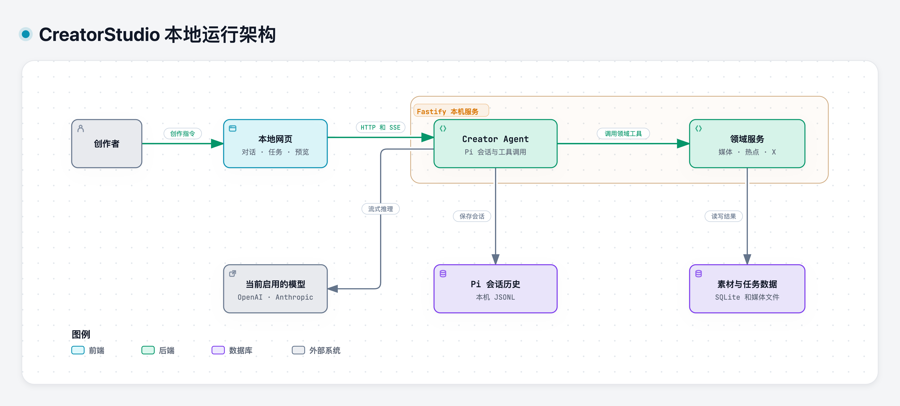
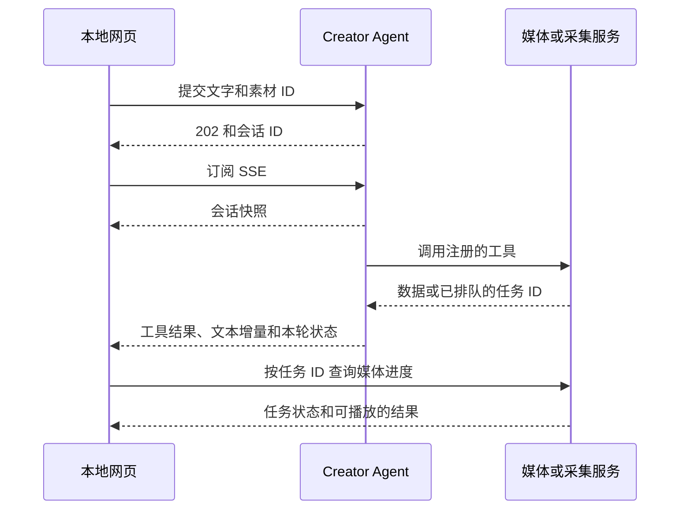

# CreatorStudio 运行架构

本地网页通过 Fastify 提交输入、接收 SSE，以及预览本地媒体。Pi 在同一个 Node.js 进程里运行会话，通过显式注册的工具调用媒体、热点和 X 服务。

| 组件 | 职责 |
| --- | --- |
| [网页](../apps/web/src/App.tsx) | 编辑并提交用户输入，显示会话、工具结果和任务状态，提供模型及采集凭据的设置 |
| [Pi 会话](../apps/server/src/agent/session-service.ts) | 加载模型和本轮工具，管理运行和停止，发布可重连的会话快照和增量 |
| [Pi 运行时](../apps/server/src/agent/runtime.ts) | 配置 Creator 指令和资源，注册创作工具，按模型设置选择 OpenAI Chat Completions 或 Anthropic Messages |
| [热点服务](../apps/server/src/harness/trends/index.ts) 与 [X Monitor](../apps/server/src/harness/x-monitor/index.ts) | 管理采集状态、定时任务、选题、推文与登录会话 |
| [媒体服务](../apps/server/src/services/media.ts) | 登记原始媒体，使用 yt-dlp 下载，使用 FFmpeg 导出，保存并提供可查询的任务状态 |

## Agent 规则和工作流

运行资源集中在 `apps/server/src/agent/content/`。服务启动时读入规则和模板，构建将整个目录复制到 `apps/server/dist/content/`。仓库根目录的 `AGENTS.md` 记录开发约定。

| 文件 | 使用时机 |
| --- | --- |
| [AGENTS.md](../apps/server/src/agent/content/AGENTS.md) | 创建 Pi 会话时用作系统指令。查询已采集资料的指引适用于同时提供 `search_x_posts` 和 `get_messages` 的会话 |
| [采集 Skill](../apps/server/src/agent/content/skills/collection-research/SKILL.md) | 会话提供 `search_x_posts` 时开放 `read_skill`。Agent 调用后读取安排采集、管理监控和研究 X 的步骤 |
| [X 草稿工作流](../apps/server/src/agent/content/workflows/x-drafts.md) | 调度器为 `x-drafts` 任务附加选题、引用和提交流程。有新增消息时将任务指令交给模型 |
| [messages.json](../apps/server/src/agent/content/messages.json) | 处理附件、触发定时任务、带入草稿结果或检查模型连接时填充对应模板 |
| [tool-metadata.json](../apps/server/src/agent/content/tool-metadata.json) | 注册工具时提供标题、说明和参数文案 |

## 一轮对话

Pi SessionManager 把用户消息、助手回复和工具结果保存为 JSONL。服务端用自定义会话条目保存上传素材引用和运行结果。重新打开会话时从这份历史恢复，重连时由当前会话发送快照。

媒体、采集与摘要有独立队列和数据库。停止 Pi 运行后，已经提交的异步任务继续由业务服务管理。服务重启时，遗留的排队或运行中媒体任务标记为失败，可通过 Agent 重新提交。热点自动摘要从当前设置获取模型，和 Pi 对话共用连接配置。

[Archify 设计源文件](diagrams/creator-agent.archify.json) · [API 契约](API.md)
